# CargoTrace – Entity-Relationship Diagram (ERD) & Data Dictionary

> **Reference**: Web Programming 2 Final Project Brief (`CargoTrace_UAS_Final_Project_Brief_2.pdf`, Slides 11 & 18)  
> **Multimodal Extension**: Option A (Single-Mode per Shipment: `SEA`, `AIR`, `ROAD` with strict location-type and carrier-mode compatibility rules).

---

## 1. Entity-Relationship Diagram (Mermaid)

```mermaid
erDiagram
    USERS ||--o{ SHIPMENTS : "owns (customer_id)"
    USERS ||--o{ SHIPMENTS : "creates (created_by)"
    USERS ||--o{ TRACKING_EVENTS : "records (recorded_by)"
    USERS ||--o{ SHIPMENT_EXCEPTIONS : "reports (reported_by)"
    USERS ||--o{ SHIPMENT_EXCEPTIONS : "resolves (resolved_by)"
    USERS ||--o{ NOTIFICATIONS : "receives (user_id)"
    USERS ||--o{ AUDIT_LOGS : "triggers (actor_id)"

    CARRIERS ||--o{ SHIPMENTS : "transports (carrier_id)"
    LOCATIONS ||--o{ SHIPMENTS : "originates_at (origin_location_id)"
    LOCATIONS ||--o{ SHIPMENTS : "terminates_at (destination_location_id)"
    LOCATIONS ||--o{ TRACKING_EVENTS : "occurs_at (location_id)"

    SHIPMENTS ||--|{ SHIPMENT_ITEMS : "contains (shipment_id)"
    SHIPMENTS ||--|{ TRACKING_EVENTS : "logs (shipment_id)"
    SHIPMENTS ||--o{ SHIPMENT_EXCEPTIONS : "experiences (shipment_id)"
    SHIPMENTS ||--o{ NOTIFICATIONS : "generates (shipment_id)"

    USERS {
        bigint id PK
        string name
        string email UK
        string password_hash
        enum role "ADMIN | OPERATOR | CUSTOMER"
        string company
        string avatar_initials
        timestamp created_at
        timestamp updated_at
    }

    CARRIERS {
        bigint id PK
        string name
        string code UK "e.g., MSK-SEA, SGC-AIR, TRK-JAV"
        enum mode "SEA | AIR | ROAD"
        string vehicle_group "e.g., Ultra Large Container Vessel"
        string contact_email
        string country
        boolean active
        timestamp created_at
    }

    LOCATIONS {
        bigint id PK
        string name "e.g., Port of Tanjung Priok"
        string city
        string country
        string code UK "UN/LOCODE, IATA, or Depot Code"
        enum type "SEAPORT | AIRPORT | DEPOT"
        decimal latitude "precision(10,6)"
        decimal longitude "precision(10,6)"
        timestamp created_at
    }

    SHIPMENTS {
        bigint id PK
        string tracking_number UK "e.g., CT-2026-0001"
        enum mode "SEA | AIR | ROAD"
        enum status "CREATED | BOOKED | PICKED_UP | IN_TRANSIT | DELIVERED"
        bigint customer_id FK "references users.id"
        bigint carrier_id FK "references carriers.id"
        bigint origin_location_id FK "references locations.id"
        bigint destination_location_id FK "references locations.id"
        string vehicle_identifier "Vessel IMO / Flight No / Truck Plate"
        timestamp scheduled_departure_at
        timestamp expected_arrival_at "Baseline contractual arrival"
        timestamp current_eta_at "Updated deterministic ETA"
        timestamp actual_delivered_at "Nullable until DELIVERED"
        decimal total_weight_kg
        decimal total_volume_cbm
        string notes
        bigint created_by FK "references users.id"
        timestamp created_at
        timestamp updated_at
    }

    SHIPMENT_ITEMS {
        bigint id PK
        bigint shipment_id FK "references shipments.id"
        string sku
        string description
        int quantity
        decimal weight_kg
        decimal volume_cbm
        string hs_code "Harmonized System Customs Code"
    }

    TRACKING_EVENTS {
        bigint id PK
        bigint shipment_id FK "references shipments.id"
        bigint location_id FK "references locations.id (nullable)"
        string location_name "Snapshot of hub/waypoint name"
        enum event_type "ORDER_CREATED | VESSEL_LOADED | FLIGHT_DEPARTED | ..."
        enum status_after "CREATED | BOOKED | PICKED_UP | IN_TRANSIT | DELIVERED"
        string description
        decimal latitude "precision(10,6)"
        decimal longitude "precision(10,6)"
        timestamp occurred_at "Chronological timestamp"
        bigint recorded_by FK "references users.id"
        string recorded_by_name
        timestamp created_at "Append-only immutable timestamp"
    }

    SHIPMENT_EXCEPTIONS {
        bigint id PK
        bigint shipment_id FK "references shipments.id"
        enum type "CUSTOMS_HOLD | WEATHER_DELAY | PORT_CONGESTION | DAMAGED | MISROUTED | DOCUMENTATION_ISSUE"
        enum severity "LOW | MEDIUM | HIGH"
        enum status "OPEN | ACKNOWLEDGED | RESOLVED"
        decimal delay_hours
        string reason_note
        string resolution_note "Required when status = RESOLVED"
        timestamp opened_at
        timestamp resolved_at "Nullable"
        bigint reported_by FK "references users.id"
        bigint resolved_by FK "references users.id (nullable)"
    }

    NOTIFICATIONS {
        bigint id PK
        bigint user_id FK "references users.id"
        bigint shipment_id FK "references shipments.id"
        string tracking_number
        enum type "STATUS_CHANGE | DELAY_ALERT | EXCEPTION_RAISED | EXCEPTION_RESOLVED"
        string title
        string message
        boolean read
        timestamp created_at
    }

    AUDIT_LOGS {
        bigint id PK
        bigint actor_id FK "references users.id"
        string actor_name
        enum actor_role "ADMIN | OPERATOR | CUSTOMER"
        string action "SHIPMENT_CREATED | STATUS_UPDATED | EXCEPTION_OPENED | ..."
        string target_type "SHIPMENT | EXCEPTION | CARRIER | LOCATION | SETTING"
        string target_id
        string summary
        json metadata
        timestamp created_at
    }

    SETTINGS {
        string key PK "e.g., delay_threshold_hours"
        string value "e.g., 12"
        string description
        timestamp updated_at
    }
```

---

## 2. Data Dictionary & Cardinality Rules (Slide 11)

| Table Name | Primary Key | Foreign Keys | Cardinality & Domain Rules |
| :--- | :--- | :--- | :--- |
| **`users`** | `id` | — | Stores system accounts with RBAC role (`ADMIN`, `OPERATOR`, `CUSTOMER`). Customers only access shipments where `shipments.customer_id = users.id`. |
| **`carriers`** | `id` | — | Logistics operators (`operator logistik`). Each carrier operates one transport mode (`SEA`, `AIR`, or `ROAD`). |
| **`locations`** | `id` | — | Multimodal nodes (`SEAPORT`, `AIRPORT`, `DEPOT`) with `code` (UN/LOCODE, IATA, or internal code) and WGS84 `latitude`/`longitude`. |
| **`shipments`** | `id` | `customer_id`, `carrier_id`, `origin_location_id`, `destination_location_id`, `created_by` | Core entity (`tracking_number` unique). Enforces Multimodal Option A compatibility between `mode`, `carrier.mode`, and `origin`/`destination` location types. |
| **`shipment_items`** | `id` | `shipment_id` (CASCADE) | `1:N` from `shipments`. Every shipment has 1 or more cargo line items with SKU, quantity, weight (kg), volume (cbm), and HS code. |
| **`tracking_events`** | `id` | `shipment_id` (CASCADE), `location_id`, `recorded_by` | `1:N` append-only log from `shipments`. Events cannot be edited or deleted once recorded (Slide 7). |
| **`shipment_exceptions`** | `id` | `shipment_id` (CASCADE), `reported_by`, `resolved_by` | `1:N` from `shipments`. Tracks operational disruptions (`CUSTOMS_HOLD`, `WEATHER_DELAY`, etc.) through `OPEN → ACKNOWLEDGED → RESOLVED`. |
| **`notifications`** | `id` | `user_id` (CASCADE), `shipment_id` (CASCADE) | `1:N` in-app notification records triggered on status transitions, delay threshold breaches, and exception updates (Slide 9). |
| **`audit_logs`** | `id` | `actor_id` | Immutable system audit trail recording who changed what and when across shipments, exceptions, and settings. |
| **`settings`** | `key` | — | Stores configurable runtime parameters such as `delay_threshold_hours` (default `12`) so threshold adjustments require zero code edits. |
